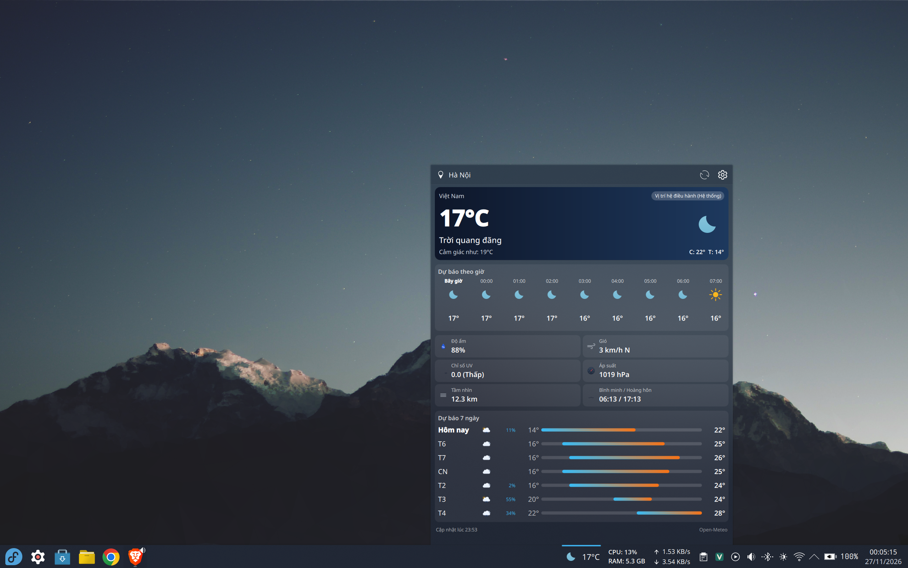
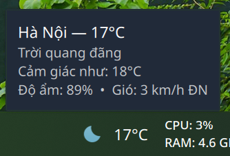
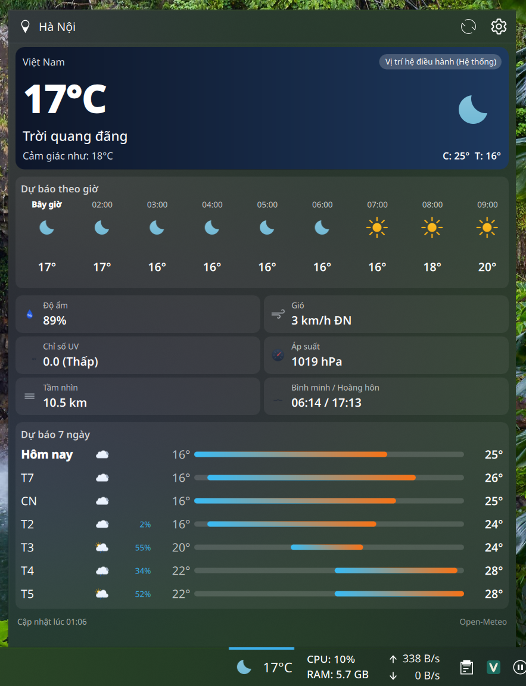

# Modern Weather (KDE Plasma 6 Widget)

Widget thời tiết hiện đại cho KDE Plasma 6 (không cần API key, sử dụng dữ liệu từ [Open-Meteo](https://open-meteo.com/)).

## Ảnh chụp màn hình / Screenshots



| Di chuột / Hover | Chi tiết / Popup |
| :---: | :---: |
|  |  |

## Tính năng chính / Features

- **Vị trí linh hoạt (Manual & OS Location):**
  - Tự động lấy vị trí của hệ điều hành qua `QtPositioning` (GeoClue2), tự động dự phòng qua định vị mạng (IP) nếu GeoClue2 không khả dụng.
  - Tìm kiếm và lưu nhiều địa điểm thủ công (hoặc nhập trực tiếp tọa độ vĩ độ/kinh độ), chuyển đổi nhanh ngay trên popup.
- **Icon taskbar động (Dynamic Taskbar Icon):**
  - Sử dụng bộ icon SVG màu **Meteocons** đóng gói sẵn, tự động thay đổi theo tình hình thời tiết thực tế (nắng, nhiều mây, âm u, sương mù, mưa phùn, mưa to, tuyết, dông bão...) và chu kỳ ngày/đêm.
  - Tùy chọn hiển thị nhiệt độ kèm đơn vị (`°C` / `°F`), tùy chỉnh phông chữ, cỡ chữ, kiểu chữ ngay trên taskbar; nhấn chuột giữa để làm mới nhanh.
- **Tùy chỉnh đơn vị hiển thị (Configurable Units):**
  - Nhiệt độ: `°C`, `°F`
  - Tốc độ gió: `km/h`, `m/s`, `mph`, `knots`
  - Áp suất: `hPa`, `inHg`, `mmHg`
  - Lượng mưa: `mm`, `inch`
  - Định dạng giờ: Theo hệ thống / `24h` / `12h`
- **Song ngữ Anh / Việt (English & Vietnamese):**
  - Mặc định tự động nhận diện ngôn ngữ hệ điều hành, tự động fallback sang tiếng Anh nếu hệ điều hành dùng ngôn ngữ khác.
  - Có thể chọn thủ công Tiếng Việt hoặc English trong phần cài đặt.
- **Dự báo chi tiết:**
  - Thời tiết hiện tại, cảm giác như, cao/thấp trong ngày, độ ẩm, gió & hướng gió, chỉ số UV, áp suất, tầm nhìn, bình minh/hoàng hôn.
  - Dự báo theo giờ (24 giờ tới) và dự báo 7 ngày với thanh biên độ nhiệt trực quan.

## Cài đặt / Cập nhật / Gỡ bỏ

```bash
# Cài đặt lần đầu
./install.sh

# Cập nhật sau khi chỉnh sửa source (tự động reload plasmashell; thêm --no-restart nếu không muốn restart)
./update.sh

# Gỡ bỏ hoàn toàn (thêm --restart để reload plasmashell ngay)
./uninstall.sh
```

Hoặc dùng trực tiếp `kpackagetool6`:

```bash
kpackagetool6 --type Plasma/Applet --install .
kpackagetool6 --type Plasma/Applet --upgrade .
kpackagetool6 --type Plasma/Applet --remove com.modernweather.widget
```

## Ghi công & Giấy phép / Credits & Licenses

- **Weather Icons:** [Meteocons](https://github.com/basmilius/weather-icons) (`@meteocons/svg-static`) by **[Bas Milius](https://bas.dev)** — licensed under the **MIT License** (see [`contents/icons/meteocons/LICENSE`](contents/icons/meteocons/LICENSE)).
- **Weather & Geocoding API:** [Open-Meteo](https://open-meteo.com/) — free non-commercial weather API.
- **Location Fallbacks:** [GeoJS](https://www.geojs.io/) (IP geolocation fallback) & [BigDataCloud](https://www.bigdatacloud.com/) (reverse geocoding).
- **Widget License:** Copyright (C) 2026 [duynguyenvp](https://github.com/duynguyenvp) — [GNU General Public License v3.0 or later (GPL-3.0-or-later)](LICENSE).
- **Repository:** [github.com/duynguyenvp/kde-modern-weather](https://github.com/duynguyenvp/kde-modern-weather)
