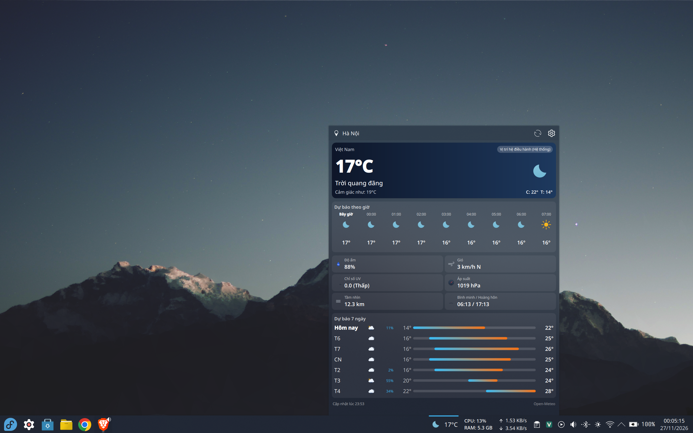
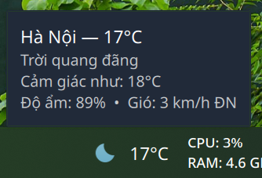
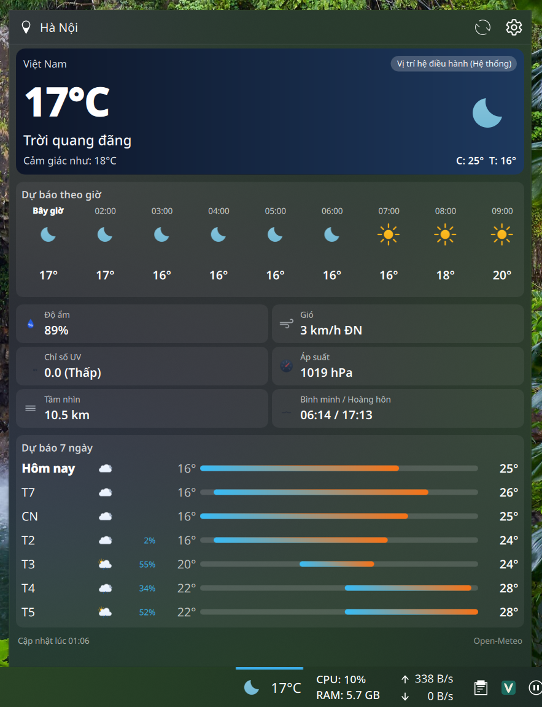

# Modern Weather (KDE Plasma 6 Widget)

**English** | [Tiếng Việt](README.md)

A modern weather widget for KDE Plasma 6 (no API key required, powered by [Open-Meteo](https://open-meteo.com/)).

## Screenshots



| Hover | Popup |
| :---: | :---: |
|  |  |

## Features

- **Flexible Location (Manual & OS Location):**
  - Automatically detects your OS location via `QtPositioning` (GeoClue2), with automatic IP geolocation fallback when GeoClue2 is unavailable.
  - Search and save multiple manual locations (or enter latitude/longitude coordinates directly) and switch between them right from the popup.
- **Dynamic Taskbar Icon:**
  - Bundles colorful **Meteocons** SVG weather icons that automatically adapt to real-time weather conditions (clear, partly cloudy, overcast, fog, drizzle, heavy rain, snow, thunderstorms, etc.) and day/night cycles.
  - Option to show temperature with unit (`°C` / `°F`), customizable taskbar font family, size, and style; middle-click to refresh immediately.
- **Configurable Units:**
  - Temperature: `°C`, `°F`
  - Wind speed: `km/h`, `m/s`, `mph`, `knots`
  - Pressure: `hPa`, `inHg`, `mmHg`
  - Precipitation: `mm`, `inch`
  - Time format: System default / `24h` / `12h`
- **Bilingual (English & Vietnamese):**
  - Automatically detects the OS language by default and falls back to English for other languages.
  - Manually switchable between English and Vietnamese in the widget settings.
- **Detailed Forecast:**
  - Current weather, feels-like temperature, daily high/low, humidity, wind speed & direction, UV index, pressure, visibility, and sunrise/sunset times.
  - Hourly forecast (next 24 hours) and 7-day forecast with visual temperature range bars.

## Installation / Update / Uninstall

```bash
# First-time installation
./install.sh

# Update after modifying source (reloads plasmashell; pass --no-restart to skip restart)
./update.sh

# Completely remove the widget (add --restart to reload plasmashell immediately)
./uninstall.sh

# Build a .plasmoid package
./build.sh
```

Or use `kpackagetool6` directly:

```bash
kpackagetool6 --type Plasma/Applet --install .
kpackagetool6 --type Plasma/Applet --upgrade .
kpackagetool6 --type Plasma/Applet --remove com.modernweather.widget
```

## Credits & Licenses

- **Weather Icons:** [Meteocons](https://github.com/basmilius/weather-icons) (`@meteocons/svg-static`) by **[Bas Milius](https://bas.dev)** — licensed under the **MIT License** (see [`contents/icons/meteocons/LICENSE`](contents/icons/meteocons/LICENSE)).
- **Weather & Geocoding API:** [Open-Meteo](https://open-meteo.com/) — free non-commercial weather API.
- **Location Fallbacks:** [GeoJS](https://www.geojs.io/) (IP geolocation fallback) & [BigDataCloud](https://www.bigdatacloud.com/) (reverse geocoding).
- **Widget License:** Copyright (C) 2026 [duynguyenvp](https://github.com/duynguyenvp) — [GNU General Public License v3.0 or later (GPL-3.0-or-later)](LICENSE).
- **Repository:** [github.com/duynguyenvp/kde-modern-weather](https://github.com/duynguyenvp/kde-modern-weather)
